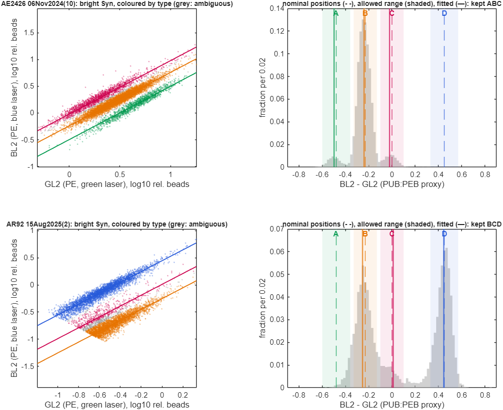
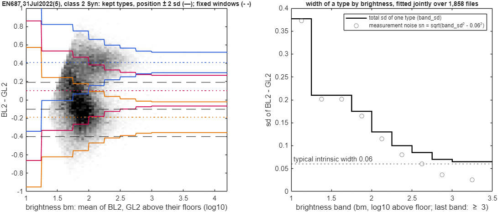
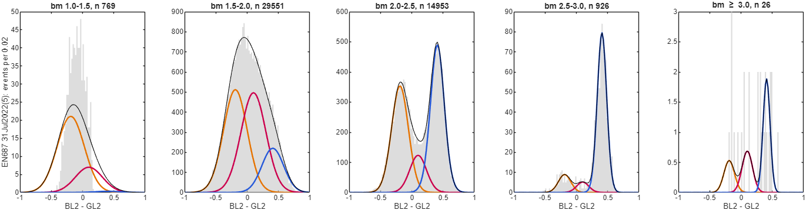
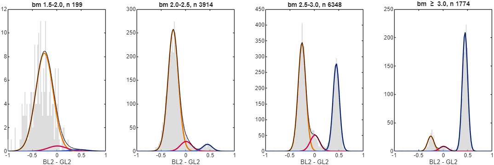
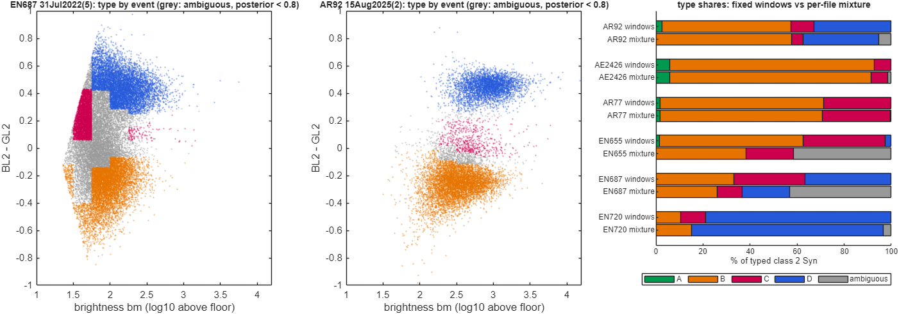

# How Syn typing works

*November 2026. Code: `assign_class_v2.m` (Syn typing block) and `syn_type_mixture.m`; settings in `classifier_config.m` (`cfg.sig.syn_type_*`, `cfg.sig.syn_mix`). Figures (in `reports/syn_typing/`) were made from the classifier as of commit 9333d61 (27 Nov 2026), by running six example files through it with `output/syn_type_d/doc_data.m` and `doc_figs.m` (not tracked).*

Syn types are a label on top of the class. The class codes (2 = Syn, 5 = Euk with Syn, 8 = Syn on particle) and their counts do not change. Each Syn-bearing event also gets a **spectral type** in `info.syn_type`. The same codes are used underway and in discrete (preserved) samples:

| code | meaning |
|---|---|
| 1–4 | type A, B, C, D, in order of rising BL2 − GL2 (A = lowest PUB:PEB, D = highest) |
| 5 | type ambiguous: no type has a posterior of at least 0.8 (mixture files only) |
| 9 | Syn-bearing, but the spectrum is not usable (BL2 or GL2 saturated, or within 1 log10 of its floor) |
| 0 | not a Syn-bearing event |

## 1. The type axis: BL2 − GL2

Phycoerythrin (PE) with more phycourobilin (PUB) is excited relatively better by the blue laser. Both PE channels are bead-normalized log10 heights, so their difference, **BL2 − GL2**, is a PUB:PEB proxy that does not depend on cell brightness. On a GL2-vs-BL2 cytogram each type is a diagonal line, BL2 = GL2 + position.

The four types sit at nominal positions **A −0.48, B −0.23, C 0.00, D +0.45** (`syn_mix.mu0`). In the example files below, B is the main type in most files. D dominates in EN720 and is a large share of AR92. A is a few percent in AE2426 and AR77.

*Bright Syn (bm ≥ 2.5) in two files. Left: GL2 vs BL2, coloured by the assigned type, with the fitted positions as lines. Right: histogram of BL2 − GL2. Dashed lines are the nominal positions, shaded bands are the range each position may move per file, and solid lines are the positions fitted in that file. AE2426 keeps A, B, C. AR92 keeps B, C, D.*

## 2. The difficulty: the ratio gets noisy for dim Syn

The difference of two log signals is sharp for bright cells. It spreads out as cells get dimmer because measurement noise grows near the floor. Brightness here is **bm**, the mean of BL2 and GL2 above their floors (log10). The mean is used rather than the dimmer channel because it is not biased by the ratio's own noise.

The width of one type was fitted per brightness band jointly over 1,858 files from 10 cruises (`syn_mix.band_sd`, right panel). It is about 0.065 for bright Syn and more than 0.2 below bm 1.75. Fixed windows (dashed lines, left) therefore cut a dim type B population into A and C. In summer, when much of the Syn is dim, that made up to 5–7% false type A.

An earlier hypothesis was that channel offsets from zero bend the dim edge in log space. That was tested on field files and bead runs and rejected: the bead BL2 offset is too small, and the dim spread is symmetric noise.

*Left: class 2 Syn of a dim summer file (EN687), BL2 − GL2 against brightness. Coloured lines are each kept type's position ± 2 sd as the mixture models it, which widens in dimmer bands. Black dashed lines are the old fixed window edges. Right: the fitted total width of one type by brightness band, and the measurement noise left after taking out a typical intrinsic width of 0.06.*

## 3. Per-file mixture (the default)

When a file has at least **500 typed class 2 Syn** (`syn_mix.min_n`), `syn_type_mixture` fits a one-dimensional Gaussian mixture along BL2 − GL2 to that file's class 2 Syn. Brightness enters only through the noise width and band weights.

- **Components.** One Gaussian per type A–D, plus a broad outlier component (mean 0.1, sd 0.5, at most 5% of any band).
- **Positions.** One position per type per file, shared by all brightness bands, so bright events (narrow peaks) set it. It may move within ±0.10–0.12 of the nominal position (`syn_mix.win`).
- **Widths.** Each type's variance is its intrinsic width plus the band's measurement noise. The intrinsic width (0.03–0.08) is fitted per type and file. The noise (`band_sd² − 0.06²`) is fixed from the joint fit.
- **Weights per brightness band.** The share of each type may differ between bands, because dim Syn can be a different population than bright Syn. Band weights are pulled toward the file's overall weights by 200 pseudo-events (`syn_mix.alpha`), so sparse bands follow the file.
- **Fitting.** The fit is EM on a 0.02 × 0.25 histogram (ratio × brightness band), so the fit cost depends on the histogram, not on the number of events. In tests it added no measurable time to `assign_class_v2`.

*The same fit seen by brightness band, with the histogram of BL2 − GL2 in grey, each kept type in its colour and the total in black. In bright bands the types are separate peaks. In dim bands they merge into one broad hump, and the shared positions and the known noise width decide how it is split. Top: EN687 (summer, mostly dim). Bottom: AR92. In EN687 the dimmest band (bm 1.0–1.5) is narrower than the model's noise for that band, so the model overestimates the noise there.*

### Which types a file keeps

All four types start in the model. Types are then dropped one at a time (backward elimination). At each step, the type whose removal loses the least log-likelihood is dropped, as long as that loss is below **30 × log n** (`syn_mix.pen`; n = fitted events). Two cases are dropped regardless of cost:

- a type with less than 1% of the file (`syn_mix.wmin`);
- a type with less than 10% whose position has run to its limit next to a kept type (`syn_mix.shoulder_max`). That is a shoulder of the neighbouring peak, not a population of its own.

The large penalty is deliberate: a fourth Gaussian always improves the fit a little, and an unneeded type steals events from its neighbours. With this rule, summer files no longer keep a false type A: the type A share in summer cruises fell from 5–7% (windows) to 0.1–0.6%. AE2426, where A is real, keeps it in 194 of 301 files, and its A share is unchanged (2.7%).

### From fit to code

Every typed event (class 2, 5 or 8) gets posteriors for the kept types, using the weights of its own brightness band. Euk with Syn (5) and Syn on particle (8) take posteriors from the class 2 fit. The type with the highest posterior is assigned if its posterior is **at least 0.8** (`syn_mix.pmin`). Otherwise the event gets **code 5, ambiguous**.

*Left and middle: each event's code against brightness (grey = ambiguous). In bright Syn almost every event is typed. In dim Syn the overlap region between types becomes ambiguous rather than being forced into one type. The step pattern comes from the per-band weights. Right: class 2 type shares in the six example files with the fixed windows and with the mixture.*

Soft counts (each type's summed posteriors) give type shares that do not depend on the 0.8 cut. They are the better choice for abundance in dim files, where many events are ambiguous.

Example files (class 2, % of typed Syn; dropped types with drop cost / log n, `-Inf` = dropped regardless of cost):

| file | kept | positions | windows A/B/C/D | mixture A/B/C/D + ambiguous | soft A/B/C/D | dropped |
|---|---|---|---|---|---|---|
| AR92 15Aug2025(2) | BCD | −0.25, 0.01, 0.45 | 2.5 / 54.9 / 9.8 / 32.8 | 0 / 57.5 / 5.0 / 32.1 + 5.4 | 0 / 59.4 / 8.3 / 32.3 | A (rule) |
| AE2426 06Nov2024(10) | ABC | −0.50, −0.24, −0.02 | 5.8 / 86.8 / 7.3 / 0 | 5.8 / 85.6 / 7.2 / 0 + 1.4 | 6 / 86 / 8 / 0 | D (rule) |
| AR77 16Oct2023(1) | ABC | −0.51, −0.24, −0.02 | 1.7 / 69.7 / 28.6 / 0.1 | 1.6 / 69.1 / 28.9 / 0 + 0.3 | 1.7 / 69.3 / 29 / 0 | D (rule) |
| EN655 26Jul2020d | BC | −0.25, −0.03 | 1.6 / 60.8 / 35.1 / 2.5 | 0 / 38.3 / 20.1 / 0 + 41.6 | 0 / 58.9 / 41.1 / 0 | D (rule), A (5.5) |
| EN687 31Jul2022(5) | BCD | −0.19, 0.10, 0.41 | 0.1 / 32.9 / 30.3 / 36.7 | 0 / 26.0 / 10.5 / 20.3 + 43.2 | 0 / 40.9 / 32.1 / 27.0 | A (rule) |
| EN720 09Sep2024b (7) | BD | −0.16, 0.38 | 0.1 / 10.5 / 10.6 / 78.8 | 0 / 15.1 / 0 / 81.4 + 3.5 | 0 / 16.9 / 0 / 83.1 | A, C (rule) |

Over whole cruises, ambiguous events are 3–6% of Syn in cruises with bright Syn and 22–34% in dim summer cruises (single dim files reach about 40%, as above). In preserved runs the share is 1–2%.

## 4. Fixed windows (the fallback)

Files with fewer than 500 typed class 2 Syn use fixed edges on BL2 − GL2 at **−0.40, −0.10, +0.19** (`syn_type_edges`). For dim Syn the A/B edge moves left: below 2 log10 above the floor in the dimmer of BL2 and GL2, it shifts 0.4 per log10 of shortfall (`syn_typeA_min_above_floor`, `syn_typeA_dim_slope`). These files have no code 5 and no soft counts. Setting `cfg.sig.syn_mix.on = false` uses the windows everywhere.

## 5. Discrete (preserved) samples

`assign_class_discrete` calls `assign_class_v2`, so preserved runs use the same typing and codes. Preserved Syn sit about 0.06 higher on BL2 − GL2, so `discrete_config.m` shifts the window edges and the mixture positions up by 0.06. The type letters mean the same populations as underway. Band noise is the same as underway (preserved Syn are brighter, so it matters less).

## 6. Where the results go

- **Class files** (`process_cruise` classify): `syn_type` per event, and `class_meta.syn_mix` per file. That struct holds the method (`mixture`/`windows`), the kept types, positions, widths, the elimination path, soft counts for classes 2/5/8 × types A–D, and the number of ambiguous events.
- **Underway table** (`generate_attune_table.m`): Syn counts by type, an ambiguous count, and `Syn_typeA_soft` … `Syn_typeD_soft` (class 2 soft counts; NaN for window files).
- **Discrete tables** (`preserved_table.m`, `merge_discrete_tables.m`): type A–D and ambiguous groups.
- **Cruise review**:
  - The Syn-type panels draw each file's kept positions as coloured lines (window files show the fixed edges).
  - Ambiguous events are drawn in the same dark grey as untyped ones.
  - There is an "ambiguous-type Syn share" metric and a "Syn typing" row in the side panel.

Existing class files and reviews keep window types until each cruise is reclassified with `process_cruise` classify.

## 7. Known limits

- The band noise is one curve for all cruises and files. Where a file's dim Syn are tighter than that (EN687's dimmest band above), the model is too wide there. That costs some typed events (more ambiguous) rather than causing wrong types.
- The per-band weights can make the type of dim events change in steps at the band edges (EN687, middle-left figure).
- The positions may move only within their windows. A population between two nominal positions is split between them or left ambiguous.
- Type shares from hard codes in dim files are low on every type because of the ambiguous events. Use soft counts there.

Background, tests and earlier versions are in `classifier_dev/output/syn_type_d` and the README section "Syn types from a per-file mixture (26 Nov 2026)".
